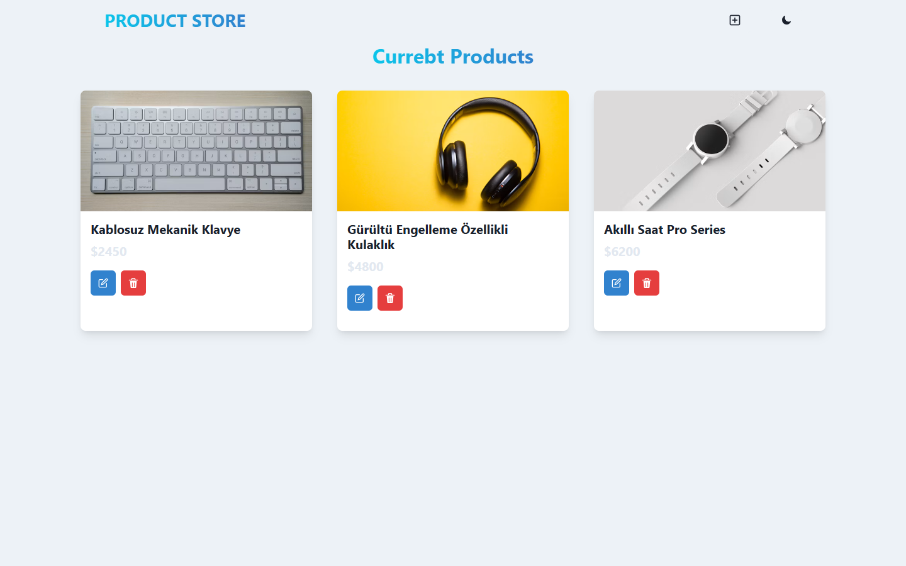

# 🛒 MERN Stack Product Store (`mern-crash-project`)



**MERN Stack (MongoDB, Express.js, React, Node.js)** mimarisiyle geliştirilmiş tam kapsamlı (full-stack) bir ürün yönetim ve mağaza uygulaması. Kullanıcıların yeni ürün ekleyebildiği, mevcut ürünleri güncelleyebildiği ve silebildiği (CRUD), durum yönetimini **Zustand** ile gerçekleştiren ve **Chakra UI** ile duyarlı (responsive) açık/koyu tema desteğine sahip modern bir web projesidir.

---

## ✨ Öne Çıkan Özellikler

- **Tam Kapsamlı CRUD İşlemleri:** Ürün oluşturma, listeleme, modal üzerinden anlık düzenleme ve silme.
- **Global Durum Yönetimi (`Zustand`):** Karmaşık prop aktarımı olmadan merkezi mağaza (store) üzerinden API senkronizasyonu.
- **Açık / Koyu Tema Desteği (`Chakra UI`):** Tek tıkla gece ve gündüz modu geçişi.
- **RESTful API Mimarisi:** Express.js ve Mongoose ile yapılandırılmış modüler controller ve route katmanları.
- **Birleşik Dağıtım (Single Deployment):** Üretim ortamında hem backend API'sini hem de derlenmiş React önyüzünü tek sunucu üzerinden sunabilme.

---

## 🛠️ Kullanılan Teknolojiler

| Katman | Teknoloji |
| :--- | :--- |
| **Frontend** | React 18, Vite 7, Chakra UI, Framer Motion, React Router v7, Zustand |
| **Backend** | Node.js, Express.js, CORS, dotenv |
| **Veritabanı** | MongoDB, Mongoose ODM |
| **Geliştirme Araçları** | Nodemon, Concurrently, Cross-Env, ESLint |

---

## 📂 Proje Klasör Yapısı

```text
mern-crash-course/
├── backend/
│   ├── config/           # MongoDB veritabanı bağlantı yapılandırması
│   ├── controllers/      # Ürün CRUD iş mantığı (controller fonksiyonları)
│   ├── models/           # Mongoose veri şemaları (Product modeli)
│   ├── routes/           # Express API uç noktaları (/api/products)
│   └── server.js         # Express sunucu giriş noktası
├── frontend/
│   ├── public/           # Statik dosyalar
│   ├── src/
│   │   ├── components/   # Navbar, ProductCard ve UI bileşenleri
│   │   ├── pages/        # HomePage ve CreatePage sayfaları
│   │   ├── store/        # Zustand global durum yönetimi (product.js)
│   │   ├── App.jsx       # Ana uygulama ve yönlendirme (routing)
│   │   └── main.jsx      # React DOM giriş noktası
│   ├── package.json      # Önyüz bağımlılıkları
│   └── vite.config.js    # Vite ve API proxy yapılandırması
├── public/
│   └── screenshots/
│       └── preview.png   # Uygulama önizleme görseli
└── package.json          # Kök dizin (Backend & ortak) bağımlılıklar ve betikler
```

---

## 🚀 Kurulum ve Çalıştırma

### Gereksinimler

- **Node.js:** `>= 18.x`
- **MongoDB** (Yerel veya MongoDB Atlas bağlantı URI'si)

### Adımlar

1. **Depoyu klonlayın:**
   ```bash
   git clone https://github.com/Sermedsefaa/mern-crash-project.git
   cd mern-crash-project
   ```

2. **Kök dizin (Backend) ve Frontend bağımlılıklarını yükleyin:**
   ```bash
   npm install
   npm install --prefix frontend
   ```

3. **Ortam değişkenlerini yapılandırın:**
   Proje kök dizininde bir `.env` dosyası oluşturun:
   ```env
   MONGO_URI=mongodb+srv://<kullanici>:<sifre>@cluster.mongodb.net/products?retryWrites=true&w=majority
   PORT=5000
   ```

4. **Geliştirme sunucularını başlatın:**
   - **Backend sunucusunu başlatmak için (Kök dizinde):**
     ```bash
     npm run dev
     ```
   - **Frontend sunucusunu başlatmak için (`frontend` dizininde):**
     ```bash
     cd frontend
     npm run dev
     ```
   Tarayıcınızda `http://localhost:5173` adresini açarak uygulamayı kullanabilirsiniz.

5. **Üretim (Production) derlemesi ve başlatma:**
   ```bash
   npm run build
   npm start
   ```

---

## 📄 Lisans

Bu proje **ISC Lisansı** altında açık kaynak olarak sunulmuştur.
